# AMOLED Kurokku (クロック)

Rust firmware that turns the [Waveshare ESP32-C6-Touch-AMOLED-2.16](https://www.waveshare.com/esp32-c6-touch-amoled-2.16.htm)
into a networked desk clock: seven clock faces, messages, pictures, animations
and sounds on a 480×480 AMOLED, driven by playlists from
[kurokku-esp-server](https://github.com/swilcox/kurokku-esp-server).

It is the colour sibling of [led-kurokku-esp](https://github.com/swilcox/led-kurokku-esp)
and speaks the same protocol, so one server runs both kinds of clock.

<p align="center">
  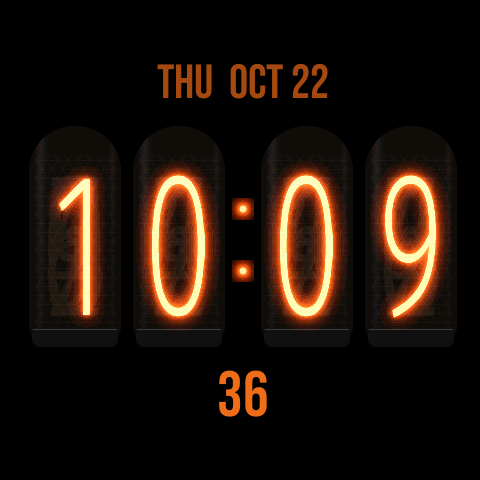
  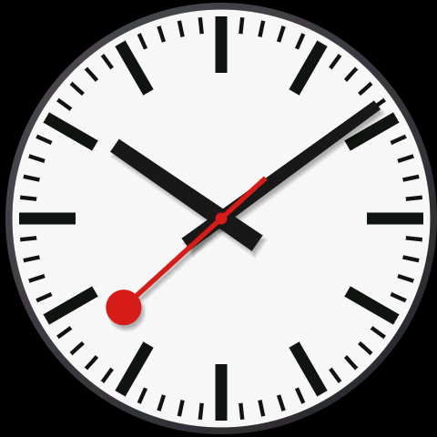
  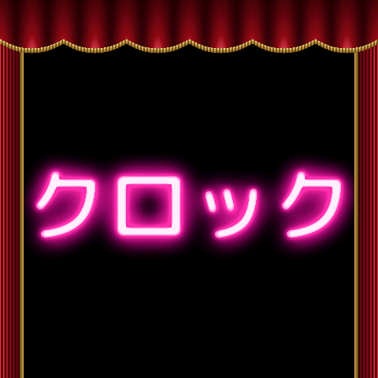
</p>

## Clock faces

KEY cycles through them on the device; the server can also pick one per playlist entry.

| `modern` | `led` | `flip` | `nixie` |
|---|---|---|---|
| 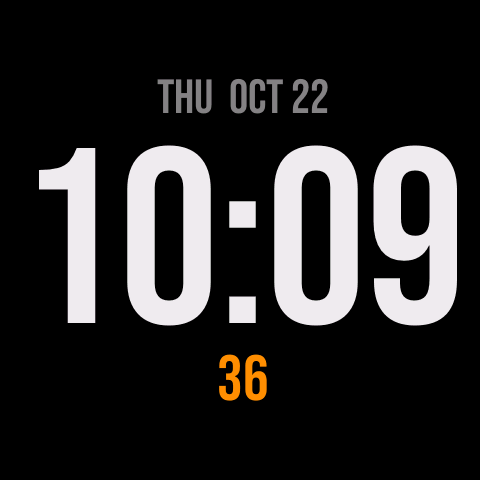 | 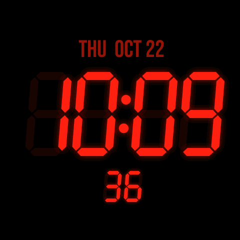 | 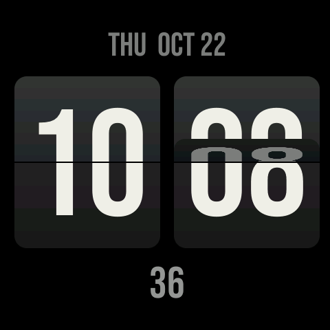 |  |
| **`railway`** | **`railway-black`** | **`classic`** | **`random`** |
|  | 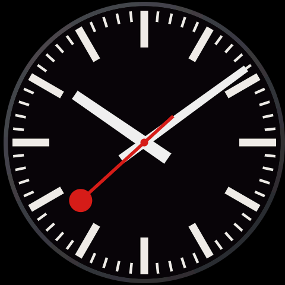 | 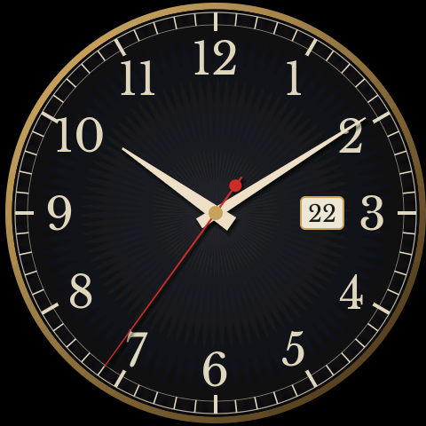 | a different face every quarter hour |

- **modern**: big anti-aliased digits with the date.
- **led**: 7-segment digits with glowing halos and faint unlit segments.
- **flip**: split-flap cards that fold over as the minute changes.
- **nixie**: glowing tubes with a crossfade between digits.
- **railway / railway-black**: a station clock whose red seconds hand sweeps round in 58.5 s, rests at 12, and sets off as the minute hand jumps.
- **classic**: a sunburst dial with ticking hands and a date window.

Every face shifts by a few pixels every couple of minutes to protect the AMOLED from burn-in.

## Animations

The server's `animation` widget, reimagined for a colour screen. Each runs until the next instruction.

| `pong` | `matrix` | `snake` | `curtain` |
|---|---|---|---|
| 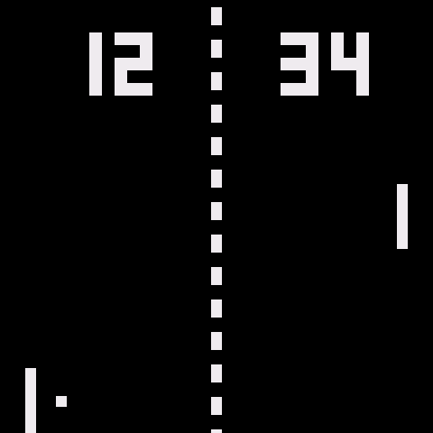 | 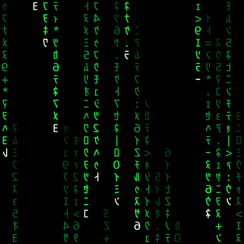 | 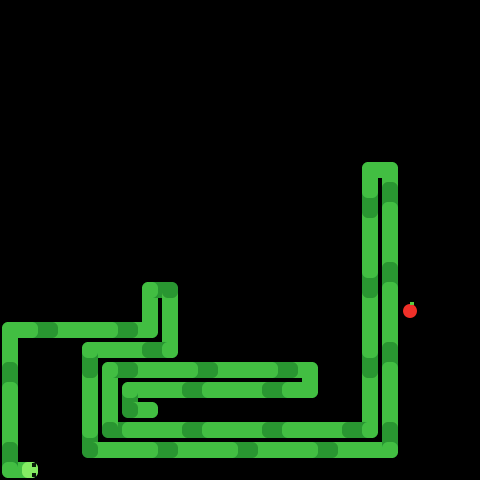 |  |
| **`sine`** | **`static`** | **`starfield`** | **`fishtank`** |
| 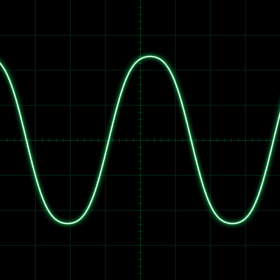 | 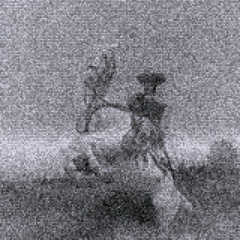 | 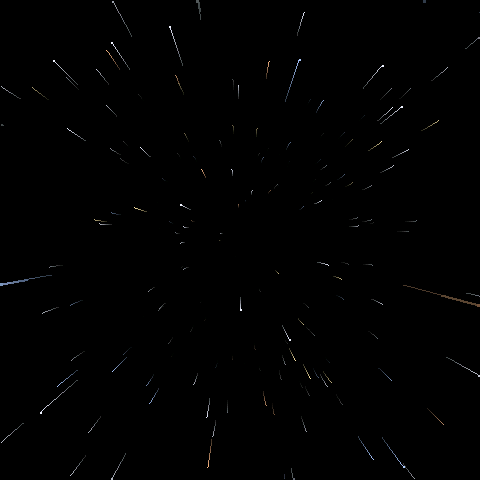 | 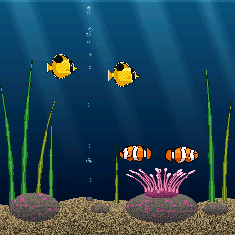 |

- **pong**: a Pong clock. The scores are the hour and minute, and the rallies are timed so the point lands as the minute changes.
- **matrix**: digital rain in mirrored half-width katakana.
- **snake**: the computer plays Snake.
- **curtain**: red velvet curtains part to reveal the クロック neon sign.
- **sine**: an oscilloscope trace drifting through shapes.
- **static**: an untuned TV. Now and then a station almost comes in: a classic TV still fades up through the snow, rolls until the vertical hold catches, and rolls away again. The stills are public domain (see [`assets/tv/SOURCES.md`](assets/tv/SOURCES.md)).
- **starfield**: flying through space, with the odd jump to warp.
- **fishtank**: a reef tank: clownfish round their anemone, butterflyfish, swaying seaweed and rising bubbles.
- **random**: one of the above each time.

## Messages, pictures and sound

| Message | Long message | Boot splash | Info screen |
|---|---|---|---|
| 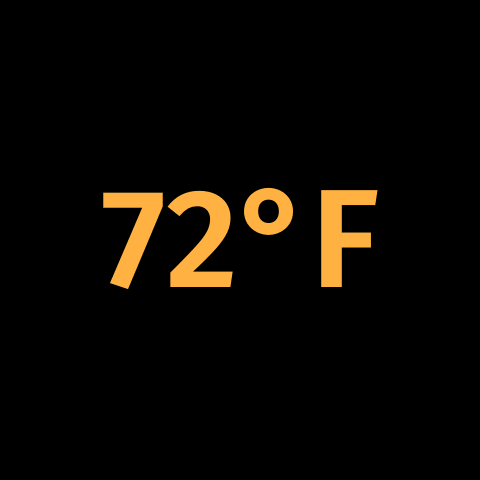 | 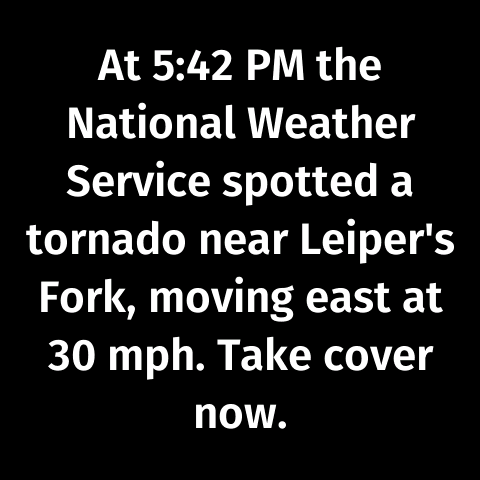 | 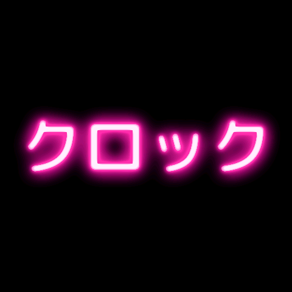 | 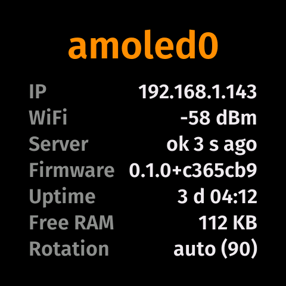 |

- **Messages**: centred when they fit, otherwise a marquee or (`direction: "up"`) a word-wrapped crawl, in any colour and three sizes. A message with a `redis_key` shows a live value such as the outdoor temperature.
- **Pictures**: QOI images from the server's image library, any URL, or the microSD card, plus slideshows of a folder on the card. `tools/img2qoi.py` converts JPEG, PNG or HEIC.
- **Sound**: any instruction can carry a WAV to play as it appears (16-bit PCM, 8–48 kHz), at a volume set per device on the server. Sounds never play during quiet hours.
- **Quiet hours**: the server can turn the screen off on a schedule; any button wakes it for a minute.

## Controls

| Input | Action |
|---|---|
| **KEY** | next clock face / close an overlay / back to the clock |
| **KEY** hold | info screen |
| **BOOT** | cycle brightness |
| **BOOT** hold | lock or unlock rotation |
| **PWR** | screen off; any button wakes it |
| tap | info screen on/off |
| swipe left / right | next / previous playlist entry |
| swipe up / down | brighter / dimmer |

The picture follows the motion sensor in all four orientations.

## Building

You need:
- Rust via [rustup](https://rustup.rs). `rust-toolchain.toml` pins the nightly and `rust-src`; ESP-IDF is downloaded on the first build.
- `cargo install ldproxy espflash`
- [just](https://github.com/casey/just) and [uv](https://docs.astral.sh/uv/) (the tools in `tools/` are self-contained uv scripts).

```sh
just build-release   # firmware plus the asset pack (fonts and artwork)
just flash           # flash both and open the serial monitor
just test            # unit tests on the host
just preview 10:09:36 nixie         # render a face to target/preview/clock.png
just preview anim static @7500      # an animation, 7.5 s in
```

The screenshots in this README come from `just preview`, which runs the same
drawing code on your computer.

### Provisioning

Each device reads its WiFi, server and time zone from NVS:

```sh
cp tools/devices/example.yaml tools/devices/kitchen-01.yaml   # edit it
just provision kitchen-01
```

Device files other than the example are gitignored, so credentials stay out of the repo.

### Server

Add the device in kurokku-esp-server with display type `amoled480` and give it
a playlist. After the first USB flash, firmware updates can go over the air:
the server tells the device where to download the new build.

## Under the hood

- **No frame buffer**: 480×480×16 bit would not fit in RAM, so everything is drawn in strips and only changed areas are redrawn.
- **Asset pack**: fonts and face artwork are built at compile time into a separate flash partition with A/B slots, keeping the app small; OTA updates the pack alongside the app.
- **Software rotation**: the panel can only mirror, so the renderer rotates each strip on its way out.

[`docs/PLAN.md`](docs/PLAN.md) has the full design notes and measurements.

## License

[MIT](LICENSE). Bundled fonts are under the SIL Open Font License (see
`assets/fonts/*-OFL.txt`); the TV stills in `assets/tv` are public domain.
